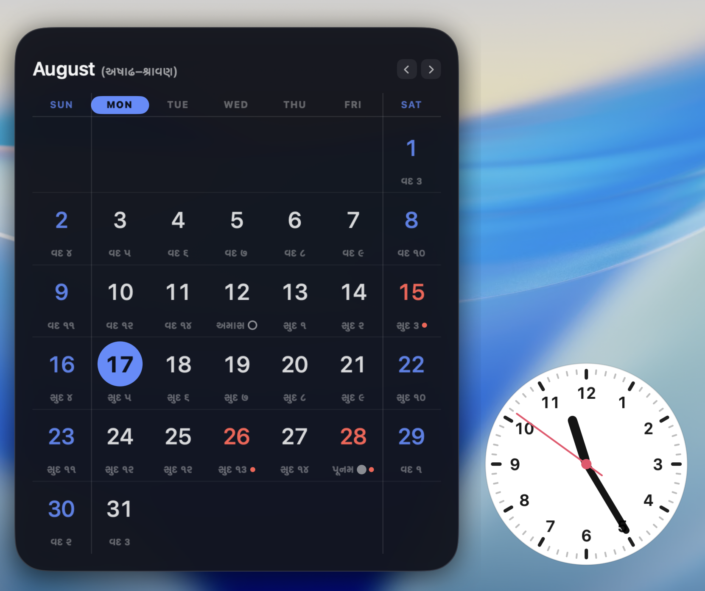
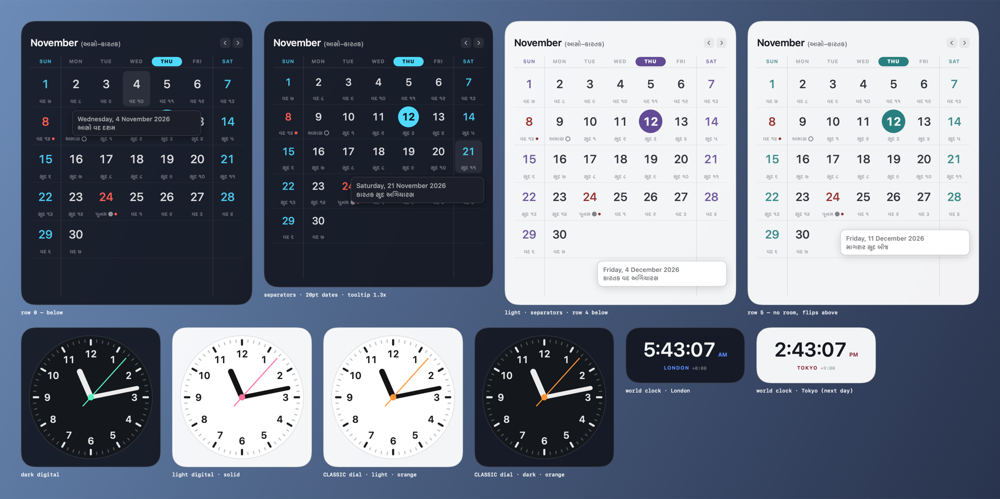

# Clock and Calendar by Dhaval

Resizable desktop widgets for macOS. Calendar first, clock included, built to have
more widgets added later.



## Features

- **Calendar** that resizes continuously, from compact up to the full screen.
- **Clock**, digital or analog, with world clocks for 50 cities.
- **Hindu calendar (panchang)**: the tithi under every date and the Hindu month
  in the header, in **Gujarati (ગુજરાતી)**, **Hindi / Devanagari (देवनागरी)** or
  **English**.
- **Only want the English date?** Turn off **Hindu calendar** in Settings and
  you get a plain Gregorian calendar. See [English only](#english-only).
- **Holidays** for India, USA and UK, plus your own dates. All computed, so any
  year works.
- **Moon phases**, dark and light themes, 20 accent colours, glass background.
- Sits on the desktop behind your windows, on every Space, with no Dock icon.
- No network access, no account, no tracking. Settings stay in one local file.



## Install

**Download.** Get the zip from the
[Releases](https://github.com/dhavall08/mac-clock-calendar-widget/releases) page.
It is a universal build (Apple silicon and Intel) for macOS 14 or later. Unzip
it and move the app to `/Applications`.

The zip is ad-hoc signed and not notarised, because notarisation needs a paid
Apple Developer account. macOS will refuse to open it the first time. Clear the
quarantine flag once:

```bash
xattr -dr com.apple.quarantine "/Applications/Clock and Calendar by Dhaval.app"
```

Or try to open it, then go to System Settings → Privacy & Security and click
**Open Anyway**.

**Or build it yourself.** This needs only the Command Line Tools
(`xcode-select --install`). No Xcode, no Apple Developer account, no payment.
It takes under a minute.

```bash
git clone https://github.com/dhavall08/mac-clock-calendar-widget.git
cd mac-clock-calendar-widget
./build.sh --install           # build, install to /Applications, launch
./build.sh --install --login   # same, and start at every login
```

Look for the calendar-clock icon in your menu bar. Everything is configured from
**Settings** (menu bar → Settings…, or ⌘, when the window is focused).

### Uninstall

```bash
./build.sh --unlogin                                         # remove the login item
rm -rf "/Applications/Clock and Calendar by Dhaval.app"
rm -rf ~/Library/Application\ Support/ClockAndCalendar       # settings
defaults delete com.dhaval.clockandcalendar
```

Quit the app from its menu bar icon first.

---

## Where things live

| | Path |
| --- | --- |
| Settings file | `~/Library/Application Support/ClockAndCalendar/state.json` |
| App bundle | `/Applications/Clock and Calendar by Dhaval.app` (`./dist/` for a build without `--install`) |
| Login item | `~/Library/LaunchAgents/com.dhaval.clockandcalendar.plist` |

The settings file is pretty-printed JSON and safe to delete to start over.
Per-widget settings are stored as an opaque blob, so adding a widget kind never
changes the document format. Every config type decodes through
`LenientDecoding.swift`, so a new option added in a later build can't reset your
existing widgets.

Settings from before the rename (`~/Library/Application Support/NebulaWidgets/`)
are migrated automatically on first launch. The old directory is left in place as
a backup; delete it whenever you like.

---

## Why this isn't a WidgetKit widget

Worth reading once, because it explains the whole design.

A real macOS widget — the kind in Notification Center or dragged onto the
desktop from the widget gallery — is a WidgetKit extension. Two of the
requirements for this project are structurally impossible there:

| Requirement | WidgetKit | This app |
| --- | --- | --- |
| Resize with a slider | ✗ Fixed sizes only (`systemSmall` … `systemExtraLarge`), picked from a menu | ✓ Continuous |
| As large as half the screen | ✗ `systemExtraLarge` is the ceiling | ✓ Up to the full screen |
| Interactive controls | ✗ Buttons/Toggles via AppIntents only — no sliders, no scrolling | ✓ Full SwiftUI |
| Install locally without paying | ✓ Free Apple ID provisioning is enough | ✓ Nothing needed at all |
| Build without full Xcode | ✗ Needs an app-extension target and `xcodebuild` | ✓ Command Line Tools only |

So this is a standalone app that behaves like a widget: a borderless glass
panel pinned to the desktop layer, on all Spaces, with no Dock icon, that
doesn't take focus when you click it.

**Gatekeeper is a non-issue for local builds.** Quarantine is applied to
*downloaded* apps. An app you compile yourself never gets the flag, so the
ad-hoc signature (`codesign --sign -`) is all macOS asks for. No certificate,
no notarisation, no 7-day expiry.

A downloaded release does get the flag. See [Install](#install).

If you ever do want a Notification Center widget as well, `CalendarMath` and
`CalendarWidgetView` are free of AppKit and app state — they can be dropped
into a WidgetKit extension unchanged, once you have Xcode installed.

---

## Using it

**Resize.** Settings → *Size & placement* → the **Size** slider. It reads out the
exact point size and what share of the screen width you're at, with
`Compact / Medium / Half screen / Max` jump buttons. You can also hover the
widget and drag the grip in its bottom-right corner.

The slider's ceiling is computed from the display the widget is currently on, so
"Max" always means "as large as fits". A calendar is taller than it is wide, so on
a 16:9 display the maximum is height-limited — roughly 45% of the screen's width
and its full height. On a 16:10 built-in display, half the screen width is
reachable.

**Move.** Drag the widget anywhere. Positions persist per widget.

**Layer.** *On desktop* (default) sits on the wallpaper behind every window —
the classic widget feel, so show your desktop to see it. *In window order* and
*Always on top* are the other two options.

**Lock.** Makes the widget ignore all clicks so it can't be nudged. Unlock from
Settings or the menu bar.

**Hide / show.** Toggle per widget in the menu bar or Settings. Hold ⌥ in the
menu bar to jump straight to a widget's settings.

### Preferences (app-wide)

- **Start at login** — writes a LaunchAgent. No entitlements or developer
  account needed. Points at wherever the running app lives, so install to
  `/Applications` before enabling it if you want it stable.
- **Hide menu bar icon** — removes the status item; widgets keep running.
  To get back in, open **Clock and Calendar by Dhaval** again from Spotlight or
  Finder and the Settings window reopens.
- **Settings window size** — `Standard / Large / Extra large / Fit screen`
  presets, and dragging the window edges is remembered too. Presets are clamped
  to the display, so *Fit screen* can't produce a window bigger than the screen.
  The settings column widens with the window rather than staying pinned narrow.

### Appearance (per widget)

- **Theme** — Dark or Light. Light isn't a tint: it's a separate palette, and
  accents are darkened so they stay legible on white.
- **Accent** — 20 colours. Every fill is flat; there are no gradients anywhere in
  the app, widgets or Settings.
- **Opacity**, **corner radius**, **glass background**.
- **Border width** (0 hides it) and **border colour** — Subtle / Accent / Neutral.
- **Neon glow** and **drop shadow**, both off by default. The shadow has to be
  clipped by the panel bounds, and the clipped edge is what reads as a faint grey
  box around the widget — leave it off unless you want it.

The Settings window itself is always dark with a **fixed blue** accent. It
deliberately does not follow the selected widget's colour — having the whole UI
change hue as you clicked between widgets read as a bug.

### Calendar options

Week starts on **Sunday** (default), Monday or Saturday · weekday labels as
`S M T` or `Sun Mon` · today as **Glow** / Solid / Ring / Bar, as a **circle or
rounded square** · today's weekday **marked in the heading** · ISO week-number
column · greyed days from adjacent months · month navigation arrows with a
*Today* reset · row separators · **weekend separators** · **Saturday and Sunday
tinted alike** · always-six-rows (so the widget never changes size month to
month) · month header on or off · **show year** · **full date footer**
("Friday, 14 August 2026" under the grid) · Rounded / System / Mono / Serif
typeface.

**Weekend separators** draw a vertical rule wherever a weekend column meets a
weekday one — with a Sunday start that's after Sun and before Sat. The positions
are derived from the rotated week, so a Monday or Saturday start still brackets
Sat/Sun correctly rather than ruling fixed columns.

#### Type sizes

Four sliders, all point sizes at 1× that the widget's own size slider then
multiplies:

| Slider | Affects |
| --- | --- |
| **Date numbers** | 1, 2, 3… — row height and today's marker grow with it |
| **Tithi & indicators** | the strip under each day; cell width grows to fit |
| **Bottom date line** | the footer, and its row height |
| **Hover tooltip** | scales the whole hover card, 0.7×–2.2× |

Row heights are *derived* from these rather than fixed, so turning the date
numbers up can't make them collide with the row below or clip the marker.

Weekend detection is computed from the weekday number rather than
`Calendar.isDateInWeekend`, which follows the locale — in several locales
(including India's) that treats Sunday alone as the weekend and would leave
Saturday styled as an ordinary weekday.

#### Holidays

Turn on **India**, **USA** and/or **UK** independently. Holiday dates take a
configurable colour that **wins over the weekend tint** when both apply, plus an
optional dot. **Minor observances** (Dhanteras, Navratri, Bhai Dooj…) are a
separate toggle.

**Choose holidays…** opens a manager where you can untick any built-in holiday
you don't care about and add your own dates — a birthday, an anniversary, a
regional holiday the rules don't cover — either repeating yearly or pinned to one
year. The built-in list is generated from the rules for the year you're browsing,
so it always shows exactly what the calendar would draw, including festivals whose
dates move. Hiding is by name, so a holiday shared by two regions disappears from
both.

**Hover any date** for an **instant tooltip**: the holiday name first, in the
holiday colour, then a gap, then the date, moon phase and tithi. It's drawn
in-widget rather than via `.help()` — the system tooltip has a delay, and a
desktop-level panel often never receives one at all. The footer shows the same
information as a single line.

The card sits **below** the hovered day with a 6pt gap so it never covers the date
it describes, flipping above only on the bottom row where there's no room left
inside the panel. It's attached to the outermost container so it draws over the
footer rather than under it.

Nothing is hardcoded to a year: dates come from rules, so 2030 works as well as
2026. See *Accuracy* below.

#### Moon and Hindu calendar

**Moon phases** marks new and full moon days — filled disc for full, hollow ring
for new — with quarters as an extra toggle.

**Hindu calendar** puts the tithi under each date in smaller type, so the
Gregorian day stays dominant. **Gujarati** is the default and is not a
transliteration: it uses the words a Gujarati panchang actually prints — સુદ / વદ
for the paksha, એકમ · બીજ · ત્રીજ for the tithis, પૂનમ / અમાસ for full and new
moon, and Gujarati numerals. Cells read `સુદ ૧૨`, `વદ ૪`, `પૂનમ`, `અમાસ`.

Pick the script under **Moon & panchang → Language**:

| Option in Settings | What it is |
| --- | --- |
| **ગુજરાતી** | Gujarati. The default. |
| **देवनागरी** | Devanagari, the script Hindi is written in. Choose this one if you read Hindi. |
| **English** | The same tithi names in Latin letters. |

With it on, the header also shows the Hindu month in brackets next to the
Gregorian one — `August (અષાઢ–શ્રાવણ)`. A Gregorian month almost always straddles
two lunar months, so both are named.

A repeated tithi on two consecutive days (*adhika tithi*) or a skipped one
(*kshaya tithi*) is correct, not a bug — a tithi is 1/30th of the Moon's
elongation from the Sun and doesn't line up with a 24-hour day.

#### English only

If you don't use the Hindu calendar, switch it off: Settings → select the
calendar → **Moon & panchang** → turn off **Hindu calendar**. The tithi row
under each date disappears, the Hindu month leaves the header, and the cells
shrink. What is left is a plain calendar with English (Gregorian) dates only.

Two more switches finish the job if you want them:

- **Holidays → Regions.** India is on by default. Pick USA or UK instead, or
  turn all of them off.
- **Moon phases.** Turn off to remove the new and full moon marks.

### Clock options

Digital or analog · 12/24-hour · seconds · date line · typeface.

- **Digit size** slider for the digital face; the panel grows to fit.
- **Dial style: Classic** reproduces the stock macOS clock — white face, black
  hands, coloured second hand with a counterweight, black 5-minute ticks with
  fine grey minute ticks between them. The face stays white whatever the widget
  theme is, and the second hand and hub take the widget's accent, so pick
  **Orange** for the stock look. **Modern** follows the theme and accent instead.
- **Dial size** and **hour number size** sliders; numerals as
  none / `3·6·9·12` / `1–12` / Roman.
- **Sweeping second hand** animates between the once-a-second ticks. It costs
  ~2.5% CPU because it redraws continuously; turn it off and the widget only
  redraws once a second.

#### World clock

**Time zone → Show time for** picks any of 50 curated cities, or *System* for this
Mac. Duplicate a clock and give the copy another city to build a row of world
clocks. The caption shows the city, its **live UTC offset**, and a `NEXT DAY` /
`PREV DAY` badge when that city is on a different date.

**Daylight saving is not computed here.** Zones are stored as IANA identifiers
(`Europe/London`) and every offset comes from `TimeZone.secondsFromGMT(for:)`
against the current instant, so the system tz database decides — London reads
`+1:00` in August and `+0:00` in January with no special-casing. The analog hands
use a calendar in that zone too, so they point at the city's time, not this Mac's.

---

## Accuracy

Holidays, moon phases and tithis are **computed**, not looked up. The astronomy
is the standard truncated series from Meeus, *Astronomical Algorithms* (ch. 25
and 47), which holds the Moon to about 0.02° — far inside what's needed to place
an event on the right day.

What was verified, and how:

- **Moon phases** — checked against Foundation's Chinese calendar, whose months
  begin on the new moon: **74 of 74 new moons over six years agreed exactly**
  once both sides used UTC+8, the timezone that calendar is defined in.
- **Holidays** — **51 of 51 known dates** across 2024–2026 for all three regions,
  including every Hindu festival listed.
- Year build costs ~15 ms and is cached per year, so it happens once.

Two things that are genuinely approximate:

- **Hindu festival dates.** A festival isn't just "this tithi at sunrise" — each
  has a traditional window during which the tithi must prevail, and the wrong one
  shifts the date by a day. The rules here carry that window: madhyahna (midday)
  for Ganesh Chaturthi, aparahna (afternoon) for Vijayadashami, pradosh (dusk) for
  Diwali, nishita (near midnight) for Maha Shivratri. Sunrise is approximated as
  06:00 local, so a boundary landing very near sunrise can shift a tithi label by
  a day. Regional panchangs disagree with each other for the same reason.
- **Islamic dates.** Foundation only offers Umm al-Qura, the Saudi tabular
  calendar. India waits on a local sighting and observes Eid a day later, so
  `HolidayRules.islamicOffsetDays` shifts them by one. A sighting can still move
  them.

Also not modelled: a public holiday being moved to the next weekday when it falls
on a weekend (UK "substitute days"), and regional/state holidays.

---

## How it scales

Widget content is always laid out at a fixed intrinsic size (`CalendarConfig.Metrics`)
and then scaled as a whole with `scaleEffect`. A 3× calendar is the same design,
just bigger, and text stays vector-sharp — as opposed to a reflowing layout,
which is where "resizable" designs usually fall apart.

---

## Adding a widget

Three steps, nothing else in the app changes.

1. **A config struct** — the widget's own settings.

   ```swift
   struct WeatherConfig: WidgetConfig {
       var showsHumidity = true
       static let defaults = WeatherConfig()
   }
   ```

2. **A provider** — identity, intrinsic size, and two views.

   ```swift
   enum WeatherWidget: WidgetProvider {
       typealias Config = WeatherConfig
       static let kind = "weather"          // never rename once saved to disk
       static let displayName = "Weather"
       static let symbolName = "cloud.sun"
       static let blurb = "Conditions at a glance."

       static func baseSize(for config: WeatherConfig) -> CGSize {
           CGSize(width: 280, height: config.showsHumidity ? 200 : 160)
       }
       static func content(_ ctx: WidgetContext<WeatherConfig>) -> some View { ... }
       static func settings(_ ctx: WidgetContext<WeatherConfig>) -> some View { ... }
   }
   ```

3. **One line in the registry** (`Core/WidgetRegistry.swift`):

   ```swift
   AnyWidgetType(WeatherWidget.self),
   ```

It now appears in Settings' gallery and the menu bar's *Add Widget*, gets the
size slider, theme, accent, accent style, opacity, layer, lock, glow and shadow
for free, and persists.

`ctx.bind(\.showsHumidity)` gives a two-way `Binding` straight into persisted
state; returning a different `baseSize` for a config change automatically
resizes the panel. Read `ctx.chrome.theme` and use `Palette.of(theme)` so the
widget honours Dark/Light, and `ctx.accent.fill(ctx.chrome.accentFill, theme:)`
so it honours gradient/solid.

---

## Layout

```text
Package.swift                     SPM executable, no Xcode project
build.sh                          build → .app → ad-hoc sign → install → login item
Resources/Info.plist              LSUIElement (menu-bar only), bundle id, icon
tools/make-icon.swift             draws the app icon at build time
docs/                             README screenshots

Sources/ClockAndCalendar/
  main.swift                      entry point + --render-preview
  App/
    AppDelegate.swift             wiring; reopen brings Settings back
    MenuBarController.swift       status item, installable/removable
    WidgetPanel.swift             borderless non-activating NSPanel
    WidgetWindowController.swift  AppState → Cocoa frames, and back on drag
    ControlCenterWindowController.swift
    PreviewRenderer.swift         offscreen PNG of every widget face
  Core/
    Models.swift                  chrome, instance, accent, theme, app settings
    WidgetProvider.swift          the extension point + type erasure
    WidgetRegistry.swift          ← add new widgets here
    AppState.swift                single source of truth, persistence, migration
    LenientDecoding.swift         missing keys fall back to defaults
    LoginItemManager.swift        LaunchAgent, no entitlements needed
    SingleInstance.swift          file lock so only one copy runs
    Astronomy.swift               sun/moon longitude, phases (Meeus)
    TimeKeeper.swift              one shared timer for the whole app
  UI/
    Theme.swift                   Palette (per-widget) + Theme (Settings window)
    GlassBackground.swift         Liquid Glass on macOS 26, material fallback
    Controls.swift                slider, segmented, toggle, chips, accents
    ViewState.swift               @State without the Xcode-only macro
    WidgetShell.swift             glass + hover toolbar + resize grip + scaling
    ControlCenterView.swift       Settings window
  Widgets/
    Calendar/
      CalendarConfig.swift        options + layout metrics
      CalendarMath.swift          month grid, weekday rotation, weekends
      HinduCalendar.swift         tithi, paksha, Amanta lunar months
      Holidays.swift              IN/US/UK rules, Easter, Islamic, festivals
      CalendarDataStore.swift     per-year cache + moon glyph
      HolidayManagerView.swift    hide built-ins, add your own
      CalendarWidgetView.swift    the face + instant tooltip
      CalendarWidget.swift        provider + settings
    Clock/
      ClockWidget.swift           both faces, classic + modern dials
      TimeZones.swift             curated world-clock zones
```

---

## Development

```bash
swift build -c release
./build.sh --run                                       # run from ./dist
.build/release/ClockAndCalendar --render-preview p.png  # offscreen preview, no windows
./build.sh --unlogin                                   # remove the login item
./build.sh --zip                                       # zip for a GitHub release

# Is the status item currently installed? (useful once it's hidden)
defaults read com.dhaval.clockandcalendar statusItemInstalled
```

Requirements: macOS 14+ to run (Liquid Glass on 26+, material fallback below),
Command Line Tools with Swift 6. Built and verified on macOS 26.5 and 27.2.

`build.sh` makes a universal binary (arm64 + x86_64) and falls back to this
Mac's architecture if the toolchain can't.

Use `@ViewState` instead of `@State` in views. With the macOS 27 SDK a bare
`@State` is a macro whose plugin ships only with Xcode, so it fails to compile
on Command Line Tools alone. `ViewState` (`UI/ViewState.swift`) is a typealias
to the same property wrapper.

Concurrency: the app is `@MainActor` throughout and builds in Swift 5 language
mode (`Package.swift`) so AppKit callbacks stay ergonomic.

### Releasing

Bump `CFBundleShortVersionString` and `CFBundleVersion` in
`Resources/Info.plist`, then:

```bash
./build.sh --zip
gh release create v1.1.0 dist/ClockAndCalendar-1.1.0.zip --title "v1.1.0" --generate-notes
```

---

## License

MIT. See [LICENSE](LICENSE).
